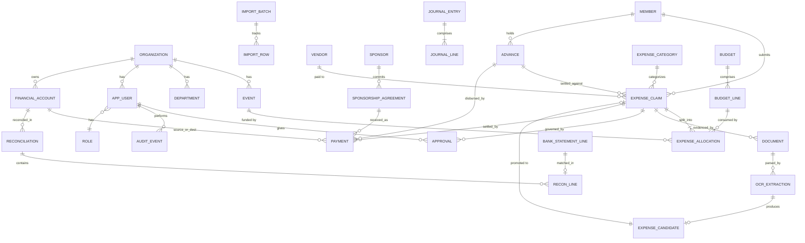

# Data Model and Accounting Design

**Date:** 2026-10-24

## 1. Accounting Architecture Decision

**Phase 1–2: structured claim/payment ledger (not double-entry).** Phase 3: add an append-only double-entry journal that mirrors approved financial events.

Rationale: a student org needs correctness and traceability more than full GAAP. A claim/payment model with explicit states + provenance gives that with far less complexity. However, the schema below is deliberately shaped so a journal can be layered on: money-movement events (payment, reimbursement, receipt, advance) each get immutable journal lines in Phase 3 without redesign. This is the same hybrid pattern lightweight fund-accounting tools use.

**Basis of reporting:** cash basis for P1–P2 reports (matches FINANCE TRACKER reality — no receivables/inventory complexity beyond sponsorships); accrual view in P3 when the journal exists. Sponsorship commitments are always visible as pipeline data regardless of basis — never blended into income until received.

**Preventing double-count (worked rule):** an expense paid personally and later reimbursed is **one expense + one payment-out (reimbursement)**. The expense's `paid_by = member`, `funding_source = member_personal`; when FINANCE TRACKER reimburses, a `Payment` (type=reimbursement) links expense ↔ member, and the expense status moves to REIMBURSED — the amount is never summed from both records. If paid directly from FINANCE TRACKER cash/bank, `funding_source = finance_tracker_cash/bank`, `Payment` type=expense_payment, no reimbursement exists. Splits create allocation lines, not duplicate expenses.

## 2. Entity Descriptions (condensed)

| Entity | Purpose | Key fields / notes |
|---|---|---|
| organization | FINANCE TRACKER (single-tenant now, multi-tenant safe) | name, fiscal_year_start, currency=NPR, settings jsonb |
| app_user / role / permission | AuthN/Z | Supabase Auth users; RBAC tables; org-scoped |
| member | FINANCE TRACKER person | name, program, batch, contact, active flag |
| department / event | Org structure & activity hierarchy | event: start/end dates, owner, status |
| expense_category | Chart of accounts (light) | code, name, parent, requires_receipt flag |
| vendor / sponsor | Counterparties | sponsor adds contact, sector |
| sponsorship_agreement | Commitment record | state machine per doc 02 §4; promised_amount, received_amount (derived), earmarked_event_id, in_kind flag |
| financial_account | Cash box / bank accounts | type, currency, current_balance (derived from ledger, not stored truth) |
| expense_claim | The core document | claimant, date_purchase, date_payment, vendor, amount, currency, fx fields, category, event(s) via allocation lines, payee_type, funding_source, payment_method, states (see 02), receipt linkage, verification_state |
| expense_allocation | Split lines | claim_id, event_id, amount; Σ(allocations) = claim amount (DB constraint) |
| payment | Money movement | type: expense_payment / reimbursement / advance_disbursement / advance_return / sponsor_receipt / income / transfer / adjustment; from/to account, counterparty, amount, date, method, reference |
| advance | Money given ahead | requester, amount, outstanding_amount, state, linked claims |
| document | Immutable file record | sha256 (unique), storage key, mime, page count, uploader, classification, superseded_by |
| ocr_extraction | Raw + field-level results | document_id, engine, version, raw jsonb, per-field confidence, reviewer corrections |
| expense_candidate | Reconstruction-only draft | links document + extraction; promoted to claim only on reviewer confirm |
| approval | Approval/rejection events | claim_id, approver, decision, reason, threshold tier |
| journal_entry / journal_line | (Phase 3) double-entry | entry: date, period, memo, reversal_of; lines: account code, debit, credit; Σdr=Σcr enforced |
| reconciliation / recon_line | Statement matching | statement doc, account, period, matched pairs, differences |
| bank_statement_line | Imported statement row | date, amount, narration, matched_claim/payment, match_confidence |
| import_batch / import_row | Import ledger | source file hash, mapping version, per-row status (imported/skipped/rejected/matched), error detail |
| audit_event | Append-only log | actor, action, entity, entity_id, before/after jsonb, ip, timestamp |
| notification | Task/reminder queue | user, type, payload, read_at, due_at |
| budget / budget_line | Planning | line: event/org/category dimension, amount, revisions versioned; consumption derived from verified+approved allocations |

## 3. Key Constraints and Indexes

- `UNIQUE(document.sha256)` — duplicate file protection.
- `CHECK (Σ allocation.amount = claim.amount)`; `CHECK (payment.amount > 0)`.
- Journal: `CHECK (debit = credit per entry)` enforced in one transaction.
- Claims immutable after `APPROVED`: all later changes = new approval/payment/verification events (state machine enforced by DB transition table, not app-only).
- Indexes: claims(event_id, status), claims(claimant, status), claims(date_purchase), payments(account, date), bank_statement_lines(amount), audit_event(entity, id), documents(classification).
- All tables carry `org_id` (enables RLS isolation + future multi-org).
- Money: `NUMERIC(14,2)`; never float.

## 4. Mermaid ER Diagram

## 5. Worked Example: One Expense, End-to-End (no double-count)

1. **Day 1:** Member A buys printing materials, NPR 3,500, personal money, for TechFest. Photographs receipt, submits. System: `expense_claim` (amount 3500, paid_by=A, funding=personal, status=SUBMITTED) + `document` (receipt photo) + `ocr_extraction` (fields, confidence).
2. **Day 2:** FM approves (`approval` row, tier check: 3,500 ≤ 2,000? No → needs executive → two approval rows). Status=APPROVED → enters PENDING_REIMBURSEMENT.
3. **Day 4:** FM pays NPR 3,500 from cash box: `payment` (type=reimbursement, amount=3500, from=cash_box, counterparty=A, claim_id). Claim status=REIMBURSED. Cash box balance derived: opening − 3,500. **Spend total counts 3,500 once** (from the claim), reimbursement is a payment event, not an expense.
4. **Day 4:** FM compares receipt vs payment → verification event → VERIFIED. Dashboard "verified spend" now includes 3,500; "outstanding reimbursements" reduced by 3,500.
5. **Phase 3:** journal entry: Dr Printing expense 3,500 / Cr Cash 3,500 (mirrors same event).
6. **Month end:** cash count matches derived balance → reconciliation row RECONCILED.
7. If amount was actually 3,050 (OCR misread): FM creates adjustment: claim stays immutable; a `payment` type=adjustment of −450 + correction note + audit event; verification states reset appropriately. Nothing overwritten.

## 6. Unverified / Undocumented Transactions

Every claim and payment carries `verification_state ∈ {UNVERIFIED, VERIFIED, DISPUTED}` and `documentation_state ∈ {COMPLETE, MISSING_DECLARED, MISSING_UNDECLARED}`. Reports must always allow filtering by these. "Missing evidence is not evidence of absence" is implemented structurally: absence = explicit state, never silent null interpretation.
